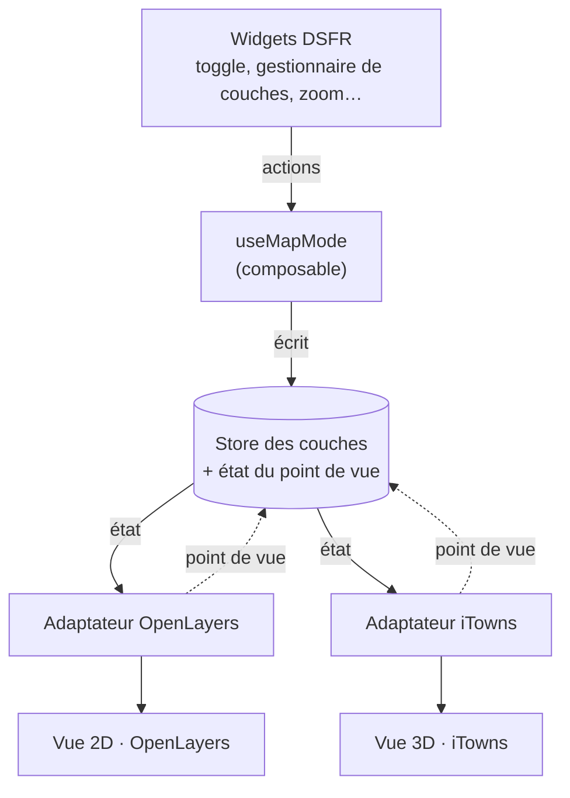
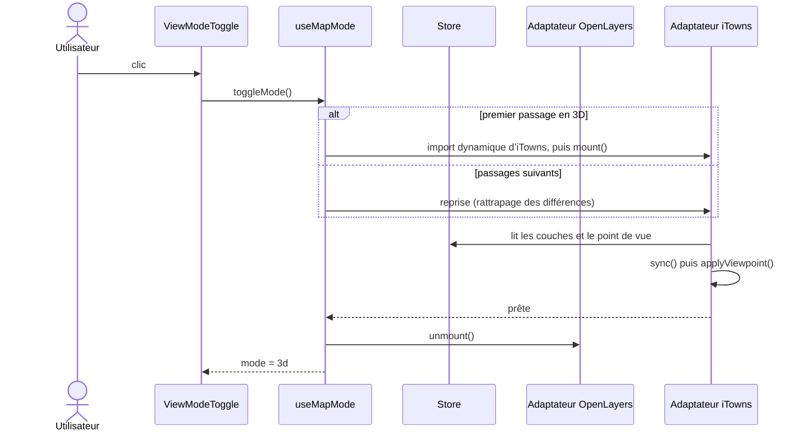

# Spécification — Intégration d’iTowns (vue 3D) dans cartes.gouv.fr-entree-carto

**Projet concerné :** cartes.gouv.fr-entree-carto (Vue 3, OpenLayers 10)

> Ce document suit le formalisme de la spécification de la librairie d’authentification Vue 3 : contexte, périmètre, exigences identifiées (FR / NFR), décisions d’architecture (ADR), questions ouvertes, historique. Les éléments marqués **\[À CONFIRMER\]** sont des hypothèses de travail à valider avant la v0.2.0.

## 1. Contexte et objectifs

### 1.1 Contexte

L’application cartes.gouv.fr-entree-carto affiche aujourd’hui ses cartes en 2D avec OpenLayers. La Géoplateforme (GPF) et l’écosystème Géoportail proposent par ailleurs iTowns, une librairie de visualisation 3D basée sur three.js, capable d’afficher un globe ou un plan 3D avec relief et couches géographiques.

L’objectif est d’offrir à l’utilisateur une vue 3D de sa carte, accessible depuis l’interface existante, sans rupture de contexte.

### 1.2 Objectifs

- Permettre de basculer de la 2D vers la 3D, et inversement, via un bouton toggle.
- Afficher en 3D les couches initialement présentes en 2D.
- Maintenir une synchronisation des couches entre les deux vues pendant toute la session.
- Conserver le point de vue (position, niveau de zoom) lors d’un changement de mode.
- Ne pas dégrader le temps de chargement initial pour les utilisateurs restant en 2D.

### 1.3 Non-objectifs

Voir section 2.2.

## 2. Périmètre

### 2.1 Dans le périmètre (v1)

- Un composant bouton toggle 2D / 3D intégré à l’interface cartographique.
- Une vue 3D iTowns instanciée à la demande (chargement différé).
- La synchronisation des couches : ajout, suppression, visibilité, opacité, ordre.
- La synchronisation du point de vue lors du basculement.
- Le support des types de couches déjà gérés en 2D, dans la limite de leur équivalent iTowns (voir FR-004).
- Les widgets communs aux vues 2D et 3D : échelle graphique (scaleline) et minimap (widgets natifs d’iTowns), gestionnaire de couches, coordonnées sous le curseur, plein écran (fullscreen), zoom, et d’autres widgets du même type (liste à arrêter, voir QO-008).
- Des widgets rendus en DSFR dans la webapp, quelle que soit la vue (voir NFR-010).
- Un point d’accès unique côté application, sous forme de composable **\[À CONFIRMER — voir ADR-002\]**.

### 2.2 Hors périmètre (v1)

- Édition de données (dessin, modification d’entités) en 3D.
- Affichage simultané 2D + 3D côte à côte.
- Outils de mesure, prévus dans une version ultérieure.
- Bâtiments 3D, MNT personnalisés, 3D Tiles et autres jeux de données propres à la 3D **\[À CONFIRMER\]**.
- Exports (impression, capture) depuis la vue 3D.
- Remplacement d’OpenLayers par iTowns pour la vue 2D.

## 3. Glossaire

| Terme | Définition |
| --- | --- |
| Vue 2D | Carte OpenLayers existante (`ol/Map`). |
| Vue 3D | Vue iTowns (globe ou plan 3D) instanciée par l’application. |
| Mode | État courant d’affichage : `2d` ou `3d`. |
| Couche source | Couche déclarée dans l’état applicatif, indépendante du moteur de rendu. |
| Adaptateur | Module convertissant une couche source en couche OpenLayers ou en couche iTowns. |
| Synchro | Mécanisme maintenant la cohérence des couches et du point de vue entre les deux vues. |

## 4. Architecture proposée

### 4.1 Principe

L’état des couches est la **source de vérité unique**, indépendante du moteur de rendu. Les deux vues sont des projections de cet état : chacune dispose d’un adaptateur qui crée, met à jour et supprime ses propres objets de couche à partir de l’état.



Les flèches pleines suivent la propagation de l’état ; les flèches pointillées remontent le point de vue de la vue active vers le store, pour que l’autre vue puisse le reprendre au basculement (FR-006).

**L’adaptateur en détail.** Un adaptateur est la seule pièce qui connaît les objets natifs d’un moteur (OpenLayers ou iTowns). Il traduit l’état du store en objets de rendu et remonte les changements du point de vue ; il ne porte aucun état métier.

**Responsabilités.**

- **Conversion** : transformer un descripteur de couche du store en couche native (voir 5.1) et déclarer si son type est supporté ou non (FR-004, FR-009).
- **Réconciliation** : comparer l’état voulu et l’état affiché, puis n’appliquer que les différences (ajout, suppression, visibilité, opacité, ordre) ; l’opération doit être idempotente (FR-005, P-06).
- **Registre** : conserver la correspondance entre l’identifiant d’une couche et son objet natif, pour la retrouver et la supprimer sans fuite (NFR-009).
- **Point de vue** : appliquer un point de vue reçu du store et émettre les changements de la vue active, avec la conversion centre, zoom et orientation propre au moteur (FR-006, R-004).
- **Cycle de vie** : monter, démonter ou suspendre, puis détruire la vue en libérant ses ressources (4.3, ADR-004, P-01, P-08).
- **Accès aux données** : construire les requêtes de tuiles avec le constructeur d’URL commun et injecter le jeton des couches protégées (P-10, FR-011).

**Règles.**

- L’adaptateur lit le store, sauf pour remonter le point de vue de la vue active.
- Aucun adaptateur ne connaît l’autre ; seul `useMapMode` les orchestre.
- Les composants Vue n’appellent jamais un adaptateur directement (ADR-002, NFR-007).
- Une couche non supportée n’est pas affichée, mais reste dans le store (FR-009).
- Seul l’adaptateur de la vue visible reçoit les mises à jour en continu ; l’autre rattrape son retard à la reprise (P-06).

**Différences entre les deux adaptateurs.**

| Aspect | Adaptateur OpenLayers (2D) | Adaptateur iTowns (3D) |
| --- | --- | --- |
| Objets de couche natifs | Couches OpenLayers (tuilées, vectorielles) | Couches iTowns (couleur, élévation, vecteur) |
| Point de vue | Centre, résolution ou zoom, rotation | Caméra : position, inclinaison, cap, distance |
| Chargement | Présent dès le départ | Import dynamique au premier passage en 3D (ADR-003) |
| Cycle de vie | Vue conservée, rendu suspendu pendant la 3D | Vue suspendue ou détruite au retour en 2D (ADR-004) |

**Contrat de l’adaptateur (provisoire, noms à confirmer).**

```typescript
interface MapAdapter {
  readonly kind: 'openlayers' | 'itowns'
  mount(container: HTMLElement): Promise<void>
  unmount(): void                      // retire la vue de l’écran, sans la détruire
  dispose(): void                      // libère les ressources (ADR-004)
  supports(layer: LayerDescriptor): boolean
  sync(layers: LayerDescriptor[]): SyncReport   // applique les différences
  applyViewpoint(viewpoint: Viewpoint): void
  onViewpointChange(cb: (viewpoint: Viewpoint) => void): () => void
}
// SyncReport : couches ajoutées, retirées, non supportées (FR-009)
```

**Séquence d’un basculement vers la 3D.**



**À préciser.** Découpage interne de chaque adaptateur par type de couche (convertisseurs distincts, voir 5.1) ; emplacement du constructeur d’URL commun (P-10) ; articulation avec les extensions Géoplateforme (geopf-extensions-openlayers et geopf-extensions-itowns) pour créer les couches du catalogue.

### 4.2 Composants

- **ViewModeToggle** : bouton de bascule, affiche le mode cible, accessible au clavier.
- **useMapMode** (composable, nom provisoire) : expose le mode courant, `setMode()`, `toggleMode()`, l’état de chargement de la 3D et les erreurs.
- **Adaptateur iTowns** : crée la vue 3D, convertit les couches, gère le cycle de vie (création, mise en veille, destruction).
- **Synchroniseur de point de vue** : convertit centre, zoom, orientation entre OpenLayers (projection de la carte) et iTowns (caméra).

### 4.3 Cycle de vie de la vue 3D

1. Premier passage en 3D : import dynamique d’iTowns et de ses dépendances, création de la vue, ajout des couches de l’état courant.
2. Retour en 2D : la vue 3D est masquée ; sa conservation en mémoire ou sa destruction est à arbitrer (QO-004).
3. Passages suivants : réactivation, puis rattrapage des modifications de couches survenues entre-temps.

## 5. Exigences fonctionnelles

| ID | Exigence | Priorité |
| --- | --- | --- |
| FR-001 | L’interface propose un bouton toggle permettant de passer de la vue 2D à la vue 3D et inversement. | Must |
| FR-002 | Le bouton indique clairement le mode actif et le mode cible, et fournit un libellé accessible (ARIA). | Must |
| FR-003 | Au premier passage en 3D, toutes les couches présentes en 2D sont affichées en 3D avec le même ordre, la même visibilité et la même opacité. | Must |
| FR-004 | Les types de couches gérés sont les couches du catalogue, les données de l’espace personnel (favoris), les imports provisoires (KML, GPX, GeoJSON) et les croquis non enregistrés ; chacun est associé à un équivalent 3D, ou explicitement déclaré non supporté (voir 5.1). | Must |
| FR-005 | Toute modification des couches (ajout, suppression, visibilité, opacité, ordre) effectuée dans un mode est répercutée dans l’autre. | Must |
| FR-006 | Le point de vue (centre, niveau de zoom équivalent) est conservé lors du changement de mode. | Must |
| FR-007 | Pendant le chargement de la 3D, l’utilisateur voit un indicateur ; la vue 2D reste utilisable jusqu’à la fin du chargement. | Should |
| FR-008 | Si la 3D ne peut pas être initialisée (WebGL indisponible, erreur de chargement), l’application reste en 2D et informe l’utilisateur. | Must |
| FR-009 | Les couches non supportées en 3D sont signalées à l’utilisateur et conservées dans l’état pour le retour en 2D. | Should |
| FR-010 | Le mode courant est persisté pour la session (et, éventuellement, reflété dans l’URL) **\[À CONFIRMER\]**. | Could |
| FR-011 | Les couches protégées nécessitant un jeton Bearer fonctionnent en 3D comme en 2D. | Must |
| FR-012 | La vue 3D permet au minimum la navigation (déplacement, zoom, rotation, inclinaison) ; l’orientation de la caméra est restituée au retour en 2D selon QO-006. | Should |
| FR-013 | Les widgets de zoom et de plein écran sont disponibles et fonctionnels en 2D comme en 3D. | Must |
| FR-014 | Le gestionnaire de couches est commun aux deux vues : il lit et modifie le store des couches (visibilité, opacité, ordre, suppression), conformément à FR-005. | Must |
| FR-015 | Les coordonnées sous le curseur sont affichées en 2D et en 3D, dans le même système de coordonnées (à confirmer, y compris l’altitude en 3D). | Should |
| FR-016 | L’échelle graphique (scaleline) et la minimap sont affichées dans les deux vues ; la minimap reste cohérente avec l’emprise courante après un changement de mode. | Should |

### 5.1 Correspondance des types de couches **\[À CONFIRMER\]**

Les couches du catalogue sont le type de couche géré de référence en v1 ; les autres types restent à arbitrer (voir QO-003).

| Type de couche 2D | Équivalent iTowns | Statut v1 |
| --- | --- | --- |
| Couches du catalogue (cartes.gouv.fr) | Couche couleur ou tuiles vectorielles, selon le format de diffusion de la couche | Supporté (type de référence v1) |
| Données de l’espace personnel (favoris) | Selon la nature des données enregistrées (couche du catalogue, import ou croquis) | À confirmer |
| WMTS (Géoplateforme) | Couche couleur (source WMTS) | Supporté |
| WMS | Couche couleur (source WMS) | Supporté |
| Tuiles vectorielles (WMTS / MVT) | Couche tuiles vectorielles | À étudier |
| Imports provisoires de données (KML, GPX, GeoJSON) | Couche de features vectorielles | À étudier (styles à convertir ; données temporaires, non persistées) |
| WFS | Couche de features | À étudier |
| Croquis non enregistrés | — | À étudier (affichage seul en 3D, l’édition restant hors périmètre) |

## 6. Exigences non fonctionnelles

| ID | Exigence |
| --- | --- |
| NFR-001 | **Performance** : iTowns et three.js sont chargés à la demande ; aucun surcoût significatif sur le bundle initial. |
| NFR-002 | **Performance** : le basculement 2D → 3D est perçu comme fluide après le premier chargement (objectif chiffré à définir). |
| NFR-003 | **Compatibilité** : support des navigateurs ciblés par le projet (browserslist, dont Safari 16) ; comportement dégradé documenté si WebGL est insuffisant. |
| NFR-004 | **Sécurité** : les données géographiques importées restent assainies avant affichage, quel que soit le moteur de rendu (cf. politique XSS existante). |
| NFR-005 | **Sécurité** : les jetons ne sont jamais exposés dans les URL de couches ; la méthode d’injection du jeton dans les requêtes iTowns est identique en principe à celle utilisée en 2D. |
| NFR-006 | **Accessibilité** : le bouton toggle respecte le DSFR et les critères RGAA applicables ; la vue 3D est documentée comme non conforme si nécessaire. |
| NFR-007 | **Maintenabilité** : le code d’adaptation iTowns est isolé du reste de l’application ; les composants Vue ne manipulent pas directement les objets iTowns. |
| NFR-008 | **Testabilité** : le composable expose un moyen de réinitialisation pour les tests ; tests E2E Playwright (Chromium, WebKit) du basculement. |
| NFR-009 | **Mémoire** : pas de fuite lors de bascules répétées (libération des ressources three.js). |
| NFR-010 | **Interface** : tous les widgets (toggle, zoom, plein écran, gestionnaire de couches, coordonnées, échelle, minimap) sont présentés en DSFR, avec un rendu et un comportement identiques en 2D et en 3D ; les widgets proviennent de geopf-extensions-itowns (DSFR) et, à défaut, les widgets natifs d’iTowns sont stylés ou remplacés en conséquence. |

## 7. Interface du composable (provisoire)

```javascript
interface UseMapMode {
  mode: Readonly<Ref<'2d' | '3d'>>
  isLoading3D: Readonly<Ref<boolean>>
  error3D: Readonly<Ref<Error | null>>
  isSupported3D: Readonly<Ref<boolean>>
  setMode(mode: '2d' | '3d'): Promise<void>
  toggleMode(): Promise<void>
}
```

**À préciser** : comment la vue 3D est montée (conteneur partagé ou distinct), et comment le store des couches est exposé aux adaptateurs.

## 8. Décisions d’architecture (ADR)

### ADR-001 — État des couches indépendant du moteur de rendu *(proposée)*

**Décision :** les couches sont décrites dans un store applicatif ; OpenLayers et iTowns en sont des projections via des adaptateurs.\
**Raison :** évite la double source de vérité et rend la synchro (FR-005) déterministe.\
**Conséquence :** le code existant qui lit directement les couches OpenLayers doit être migré vers le store.\
**Alternative écartée :** synchronisation par événements entre les deux moteurs, fragile et sujette aux boucles de mise à jour.

### ADR-002 — Composable comme point d’accès unique *(proposée)*

**Décision :** l’accès au mode 2D / 3D passe uniquement par un composable (`useMapMode`), dans la continuité du choix fait pour la librairie d’authentification.\
**Conséquence :** les composants n’importent jamais iTowns directement.

### ADR-003 — Chargement différé d’iTowns *(proposée)*

**Décision :** iTowns est importé dynamiquement au premier passage en 3D.\
**Raison :** NFR-001.

### ADR-004 — Vue 3D conservée ou détruite au retour en 2D *(à trancher)*

Compromis entre fluidité des bascules suivantes et consommation mémoire (voir QO-004).

## 9. Risques

| ID | Risque | Mitigation envisagée |
| --- | --- | --- |
| R-001 | Écarts de rendu des styles vectoriels entre OpenLayers et iTowns. | Limiter la v1 aux couches raster ; table de conversion de styles pour la suite. |
| R-002 | Compatibilité WebGL (Safari, appareils modestes), déjà sensible avec OpenLayers 10. | Détection de capacité, repli en 2D (FR-008), tests WebKit. |
| R-003 | Poids du bundle (three.js + iTowns). | Chargement différé (ADR-003), mesure en CI. |
| R-004 | Différences de projection et de niveaux de zoom entre les deux moteurs, d’où dérive du point de vue. | Tests de non-régression sur la conversion du point de vue. |
| R-005 | Authentification des couches protégées côté iTowns. | Prototype dédié avant la v0.2.0. |
| R-006 | Fuites mémoire lors de bascules répétées. | NFR-009, tests de charge manuels. |
| R-007 | iTowns n’implémente pas nativement le DSFR : les widgets natifs non couverts par geopf-extensions-itowns créent une incohérence visuelle et d’accessibilité avec le reste de l’interface. | S’appuyer sur geopf-extensions-itowns, qui gère le DSFR ; pour les widgets restants (scaleline, plein écran), les styler en DSFR ou les remplacer par des composants Vue DSFR (NFR-010). |

## 10. Questions ouvertes

| ID | Question | Bloquante |
| --- | --- | --- |
| QO-001 | Quelle version d’iTowns cibler, et quelle compatibilité avec la version de three.js déjà présente dans l’écosystème GPF ? | Oui |
| QO-002 | geopf-extensions-itowns gère le DSFR et fournit le gestionnaire de couches, les coordonnées de la souris, la minimap et le zoom (ces deux derniers peut-être hérités des widgets natifs d’iTowns, à confirmer). Restent à vérifier : la couverture de la scaleline et du plein écran, et la version d’iTowns compatible. | Oui |
| QO-003 | Quels types de couches doivent absolument être supportés en 3D dès la v1 ? | Oui |
| QO-004 | Vue 3D conservée en mémoire ou détruite au retour en 2D ? | Non |
| QO-005 | Un relief (MNT Géoplateforme) est-il activé par défaut en 3D ? | Oui |
| QO-006 | Comment restituer l’inclinaison et l’orientation de la caméra 3D au retour en 2D ? | Non |
| QO-007 | Le mode doit-il être partagé dans les URL de partage de carte ? | Non |
| QO-008 | Quels widgets 2D existants (recherche, mesures, légende…) doivent être disponibles en 3D ? | Oui |
| QO-009 | Quelle exigence de conformité (RGAA, sécurité) s’applique à la vue 3D ? | Non |

## 11. Pistes exploratoires — fluidité du basculement 2D / 3D

*Section exploratoire : rien n’est décidé. OpenLayers et iTowns sont deux moteurs lourds pour le navigateur ; chaque piste ci-dessous appelle un choix à trancher avant la v0.2.0, idéalement après mesure sur un appareil modeste et sous Safari. Les valeurs données sont indicatives.*

| ID | Piste | Choix à faire | Liens |
| --- | --- | --- | --- |
| P-01 | **Un seul moteur actif à la fois.** La carte OpenLayers est masquée sans être détruite (`updateSize()` au retour) et ne charge plus de tuiles pendant la 3D ; la vue iTowns est suspendue en 2D. | Suspendre le rendu de la vue inactive ou la détruire ; vérifier comment suspendre la boucle de rendu d’iTowns. | ADR-004, NFR-009 |
| P-02 | **Contextes WebGL.** Un seul contexte actif ; gestion de `webglcontextlost` avec repli en 2D ; détection de capacité (WebGL2, `navigator.deviceMemory` sous Chromium) pour proposer ou non la 3D. | Seuils de repli et message affiché à l’utilisateur. | FR-008, R-002 |
| P-03 | **Préchargement d’iTowns.** Au survol ou au focus du bouton, ou en `requestIdleCallback` après le premier affichage ; chunk dédié pour three.js et iTowns, servi en brotli ; initialisation découpée en petites tâches. | Déclencheur du préchargement (aucun, survol, inactivité) et coût en bande passante. | ADR-003, NFR-001 |
| P-04 | **Masquer la latence.** La 2D reste interactive pendant le chargement, puis fondu enchaîné ; caméra 3D qui démarre à la verticale, calée sur l’emprise 2D, puis s’incline progressivement. | Type de transition : coupure, fondu ou animation de caméra. | FR-006, FR-007 |
| P-05 | **Réutiliser le cache HTTP.** Mêmes URL de tuiles et même tuilage (Web Mercator) dans les deux moteurs ; niveaux de zoom déjà chargés en 2D demandés en premier en 3D. | Alignement du schéma de tuilage ; effet des jetons Bearer sur le partage du cache. Détaillé en P-10 à P-12 et testé en 11.4. | FR-011, NFR-005 |
| P-06 | **Synchronisation à la demande.** Seule la vue visible est mise à jour ; au basculement, les différences accumulées sont appliquées en un lot ; parsing des gros imports (KML, GPX, GeoJSON) dans un Web Worker. | Synchro continue ou différée ; périmètre du Web Worker. | ADR-001, FR-005 |
| P-07 | **Rendu 3D allégé.** `pixelRatio` plafonné (autour de 1,5 à 2), antialiasing désactivé sur mobile, erreur d’écran tolérée et niveau maximal de tuiles réglés, imagerie chargée avant le relief. | Valeurs par défaut ; relief activé d’emblée ou différé. | QO-005, NFR-002 |
| P-08 | **Gestion de la mémoire.** Vue 3D conservée puis libérée après un délai d’inactivité (`dispose()`, `forceContextLoss()`) ; test de bascules répétées. | Délai d’inactivité ; politique conserver ou détruire (ADR-004). | ADR-004, NFR-009 |
| P-09 | **Mesure.** `performance.mark` autour du chargement, de la création de la vue et de la synchronisation des couches ; budgets chiffrés. | Budgets à fixer (temps de bascule à chaud, premier affichage 3D) et appareils de référence. | NFR-002, NFR-003 |
| P-10 | **Cache HTTP partagé entre OpenLayers et iTowns.** Constructeur d’URL unique pour les deux moteurs (ordre des paramètres, STYLE, FORMAT, clé), même TileMatrixSet, même mode CORS (crossOrigin anonymous), en-têtes Cache-Control et ETag corrects côté serveur, sans Vary inutile. Le cache économise le réseau mais pas le décodage des images ni l’envoi des textures au GPU. | Où placer le constructeur d’URL (adaptateurs, ADR-001) ; en-têtes à demander à la Géoplateforme. | P-05, 11.2, FR-011 |
| P-11 | **Préchauffage des tuiles.** Calculer les tuiles que la 3D va demander pour l’emprise courante et les télécharger avant ou pendant la transition. | Activer ou non ; coût en bande passante (tuiles inutiles) ; sens 2D vers 3D seulement ou dans les deux sens. | P-04, P-05 |
| P-12 | **Service Worker avec API Cache.** Normalisation des URL, stratégie « périmé pendant revalidation », durée de vie maîtrisée indépendamment des en-têtes du serveur. | Complexité (portée, mises à jour, jetons) acceptable ou non ; à n’envisager que si P-10 ne suffit pas. | P-10, FR-011 |

Les choix retenus seront reportés dans les ADR, les exigences non fonctionnelles et les exigences fonctionnelles correspondantes.

### 11.1 Poids du code JavaScript : OpenLayers (2D) et iTowns (3D)

*Mesure réalisée le 17 octobre 2026 avec esbuild (bundle ESM minifié) sur les dernières versions publiées sur npm, en isolation du reste de l’application. 1 Ko = 1 000 octets.*

| Ensemble | Contenu mesuré | Minifié | gzip | brotli |
| --- | --- | --- | --- | --- |
| OpenLayers 10.11.0 | Map, View, couches tuilées et vectorielles, sources WMTS et WMS, formats GeoJSON / KML / GPX, contrôles zoom, échelle, plein écran, position de la souris, vue d’ensemble | 401 Ko | 116 Ko | 99 Ko |
| iTowns 2.46.0, imports ciblés | GlobeView, Extent, couches couleur et élévation, sources WMTS / WMS / fichier, Fetcher ; inclut la part de three.js réellement utilisée | 1 317 Ko | 369 Ko | 306 Ko |
| iTowns 2.46.0, import complet | Tout l’export de la librairie, sans tree-shaking | 1 677 Ko | 482 Ko | 398 Ko |

**Lecture.**

- Le code iTowns pèse environ trois fois celui d’OpenLayers (≈ 3,3 fois en minifié, ≈ 3,1 fois en brotli) pour un jeu de fonctionnalités équivalent à ce qui est utilisé en 2D.
- Le surcoût d’un premier passage en 3D est de l’ordre de 300 Ko compressés en brotli (≈ 370 Ko en gzip), à comparer aux ≈ 100 Ko de la 2D. Cela justifie le chargement différé (ADR-003) et le préchargement (P-03).
- Les imports ciblés économisent environ 20 % par rapport à l’import complet : les imports doivent rester nominatifs (P-03).
- iTowns 2.46.0 déclare une dépendance de pair sur three.js en `^0.174.0`, alors que la dernière version de three.js publiée est plus récente (0.186.x). L’installation avec la dernière version de three.js échoue : à vérifier avec QO-001, et à surveiller si l’application utilise déjà three.js.

**Limites de cette mesure.**

- Elle ne couvre ni geopf-extensions-itowns (introuvable sous ce nom sur le registre npm public, à mesurer depuis ses sources), ni les extensions OpenLayers de la Géoplateforme, ni vue-dsfr.
- Elle ne mesure que le code : les tuiles, textures, relief et la mémoire GPU consommés à l’exécution sont à mesurer dans le navigateur (onglets Network et Performance, `performance.mark`) pour alimenter NFR-002 et P-09.
- Les budgets chiffrés restent à fixer (P-09) ; ces valeurs en sont le point de départ.

### 11.2 Empreinte mémoire dans le navigateur : carte 2D et carte 3D

*Section exploratoire. Les valeurs ci-dessous sont des **estimations par le calcul**, à partir d’hypothèses explicites ; elles n’ont pas été mesurées dans un navigateur. Elles servent à repérer les postes dominants et à définir le protocole de mesure. 1 Mio = 1 048 576 octets.*

**Hypothèses de calcul.** Écran de 1920 × 1080 pixels CSS ; tuiles raster de 256 × 256 pixels, 4 octets par pixel une fois décodées ; une couche raster visible ; rapport de pixels (DPR) de 1, puis de 2.

| Poste | Calcul | Ordre de grandeur |
| --- | --- | --- |
| Tampon de dessin, DPR 1 | 1920 × 1080 × 4 o | ≈ 8 Mio en 2D (canvas) ; ≈ 16 Mio en 3D (couleur + profondeur 32 bits) |
| Tampon de dessin, DPR 2 | × 4 par rapport au DPR 1 | ≈ 32 Mio en 2D ; ≈ 63 Mio en 3D |
| Antialiasing multi-échantillons (MSAA ×4) en 3D | × 4 sur la couleur et la profondeur | jusqu’à ≈ 63 Mio (DPR 1) et ≈ 253 Mio (DPR 2), selon le pilote graphique |
| Tuiles raster affichées, par couche | 9 × 6 = 54 tuiles × 256 × 256 × 4 o | ≈ 13,5 Mio en 2D |
| Textures de tuiles du globe, par couche | 150 tuiles (hypothèse) × 256 × 256 × 4 o × 1,33 (mipmaps) | ≈ 50 Mio en 3D |
| Relief (QO-005) | textures d’élévation en plus de l’imagerie | À mesurer |
| Code JavaScript chargé | 99 Ko (OpenLayers) contre 306 Ko (iTowns) en brotli, soit nettement plus une fois décompressé et compilé | À mesurer |

**Lecture.**

- Le poste dominant est le **tampon de dessin** : il croît avec la surface de l’écran, le carré du DPR et, en 3D, l’antialiasing. Plafonner le `pixelRatio` et désactiver l’antialiasing (P-07) sont les leviers les plus efficaces.
- La 3D consomme plusieurs fois la mémoire de la 2D pour la même carte : tampon plus gros, textures GPU avec mipmaps, couche de profondeur, et plus de tuiles en mémoire simultanément.
- Garder les deux vues actives s’additionne et double le nombre de contextes graphiques (P-01, P-02) ; c’est le scénario à éviter, en particulier sur mobile.
- Chaque couche raster ajoutée en 3D coûte de l’ordre de la dizaine de Mio ; les couches vectorielles dépendent du nombre d’entités (imports KML, GPX, GeoJSON, croquis non enregistrés).
- Les limites de mémoire des onglets varient fortement selon l’appareil et le navigateur, et ne sont pas documentées de façon fiable : les budgets doivent être fixés à partir de mesures sur les appareils de référence (P-09).

**Protocole de mesure proposé.**

| Scénario | Mesures |
| --- | --- |
| A. 2D seule, après chargement | Tas JavaScript, mémoire GPU, mémoire du processus |
| B. 3D seule, après chargement | Idem, plus nombre de contextes WebGL |
| C. Après 10 bascules 2D ↔ 3D | Évolution par rapport à A et B (recherche de fuites, NFR-009) |
| D. 2D et 3D actives en même temps | Idem ; sert de référence haute |
| E. Après libération de la vue 3D (`dispose()`) | Mémoire récupérée |

Outils : gestionnaire de tâches de Chrome (empreinte mémoire, GPU), onglet Mémoire des DevTools (instantanés du tas), `performance.measureUserAgentSpecificMemory()` si l’isolation cross-origin le permet, inspecteur Web de Safari. Appareils : un poste de bureau, un portable d’entrée de gamme, un mobile iOS et un mobile Android.

**Choix à faire.** Plafond de `pixelRatio` et antialiasing par défaut ; taille des caches de tuiles côté OpenLayers et côté iTowns ; nombre maximal de couches raster en 3D ; budgets de mémoire par scénario et par appareil ; seuil au-delà duquel la 3D n’est plus proposée (P-02). Les choix retenus alimenteront NFR-002, NFR-009 et ADR-004.

### 11.3 Références : implémentations 2D / 3D existantes

*Références consultées le 18 octobre 2026, à partir de leur documentation publique. Aucune n’a été testée dans le cadre de cette spécification ; elles servent à s’inspirer de solutions éprouvées et à repérer leurs limites.*

| Référence | Approche | Enseignements pour entree-carto |
| --- | --- | --- |
| **SDK Web Géoplateforme 2D/3D** ([IGNF/geoportal-sdk](https://github.com/IGNF/geoportal-sdk), [documentation](https://geoservices.ign.fr/node/497), [paquet npm sdk-3d](https://www.npmjs.com/package/@ignf-geoportal/sdk-3d)) | OpenLayers pour la 2D, iTowns pour la 3D, avec les extensions Géoplateforme de chaque bibliothèque. Le mode est choisi par l’option `viewMode` (`"2d"` par défaut, ou `"3d"`), et la documentation annonce une bascule entre 2D et 3D. Le code d’une copie de test du paquet décrit une bascule qui recharge la carte avec l’autre bibliothèque en conservant projection, centre, inclinaison, azimut, zoom, couches et contrôles. | Référence prioritaire : même écosystème (OpenLayers, iTowns, extensions Géoplateforme) et même équipe de maintenance. Elle illustre le modèle « recharger la carte à chaque bascule », à comparer avec le modèle « vue 3D conservée » (ADR-004, P-01). Le détail de la bascule est à vérifier dans le dépôt officiel, la source consultée étant une copie de test. |
| **ol-cesium (OLCS)** ([dépôt](https://github.com/openlayers/ol-cesium), [documentation](https://openlayers.org/ol-cesium), [paquet npm olcs](https://www.npmjs.com/package/olcs)) | Ajoute un globe CesiumJS à une carte OpenLayers existante ; `setEnabled(true)` affiche la 3D, `setEnabled(false)` revient à la 2D. Synchronise le contexte de carte (emprise, zoom), les sources raster et vecteur, et la sélection. | Chargement de Cesium immédiat ou différé, et limitation de la consommation de ressources par détection d’inactivité : à rapprocher de P-03 et P-08. Limites documentées : les couches OpenLayers non « découvrables » ne sont pas supportées, et les interactions OpenLayers ne fonctionnent pas en 3D (à anticiper pour FR-009). Utilise CesiumJS et non iTowns : à titre d’inspiration uniquement. |
| **ArcGIS Maps SDK for JavaScript**, exemple « Switch between 2D and 3D » ([documentation](https://developers.arcgis.com/javascript/latest/sample-code/views-switch-2d-3d/index.html)) | Une carte 2D (arcgis-map) et une scène 3D (arcgis-scene) sont superposées ; le point de vue (centre, échelle, orientation) est copié de l’une à l’autre et un fondu enchaîné affiche la vue de destination. Deux autres approches sont décrites : voir la discussion ci-dessous. | Limites décrites par l’éditeur : certains types de couches n’existent pas dans l’autre mode, les symboles 3D ne sont pas tous affichables en 2D, et, avec la réaffectation de conteneur, les widgets sont détruits puis recréés à chaque bascule sauf s’ils sont préservés à la main. Confirme la nécessité de widgets communs (FR-013 à FR-016) pilotés par un état partagé. |
| **CesiumJS**, modes de scène 2D / 3D / vue Colomb ([documentation du sélecteur de mode](https://cesium.com/learn/cesiumjs/ref-doc/SceneModePickerViewModel.html)) | Moteur unique avec plusieurs modes d’affichage ; la transition est une animation (`morphTo2D`, `morphTo3D`) de durée réglable, une durée nulle donnant un changement instantané. | Architecture différente (un seul moteur) donc non transposable telle quelle, mais bon exemple de transition animée entre 2D et 3D (P-04). |

**Discussion : la bascule 2D / 3D de l’exemple ArcGIS.** L’exemple (page consultée le 18 octobre 2026) décrit trois façons de réaliser la bascule entre une carte 2D et une scène 3D, avec leurs compromis.

| Approche | Principe | Avantages | Inconvénients |
| --- | --- | --- | --- |
| **Composants superposés** (approche retenue par l’exemple) | Les deux composants sont dans la page, positionnés l’un sur l’autre ; la vue de destination apparaît par un fondu (opacité et visibilité) et reçoit une copie du point de vue. | Transition personnalisable ; widgets et superpositions restent actifs dans chaque composant ; la vue cible est déjà initialisée et disponible immédiatement. | Utilisation du GPU plus élevée, car les deux composants sont actifs. |
| **Composants superposés, masqués par l’attribut `hidden`** (variante) | Même principe, mais l’attribut `hidden` remplace la visibilité CSS. | Une seule vue rendue à la fois, donc moins de GPU ; les deux restent en mémoire et la bascule est instantanée. | Les deux vues occupent toujours la mémoire. |
| **Réaffectation de conteneur** | Un seul élément hôte : le conteneur est affecté à la vue active et retiré de l’autre. | Empreinte mémoire plus faible, une seule vue rendue ; moins de contextes WebGL. | Widgets et interface détruits puis recréés à chaque bascule sauf préservation manuelle ; pas de fondu intégré ; bref scintillement à l’initialisation ; code plus complexe. |

L’exemple recommande les composants superposés si la fluidité et la conservation de l’état de l’interface priment, la variante `hidden` si le GPU est un souci, et la réaffectation de conteneur si l’efficacité des ressources sur appareils contraints prime.

**Points techniques à retenir.**

- **Correction d’échelle en Web Mercator.** L’échelle apparente d’une carte Web Mercator augmente avec la latitude. L’exemple multiplie l’échelle par cos(latitude) en passant de la 2D à la 3D, et la divise en sens inverse, pour que la distance perçue au sol reste la même. À reprendre pour FR-006 et R-004 (dérive du point de vue entre OpenLayers en EPSG:3857 et iTowns).
- **Attendre que les deux vues soient prêtes** (`viewOnReady`) avant la première bascule : équivalent de notre chargement différé et de l’indicateur de chargement (FR-007).
- **Types de couches.** Les couches purement 3D sont retirées ou remplacées par une contrepartie 2D, et le relief est ignoré en 2D : à rapprocher du tableau 5.1 et de FR-009. Les symboles 3D ne sont pas pris en charge en 2D, ce qui renvoie à la conversion des styles (R-001).

**Mise en regard avec entree-carto.**

- Les trois approches correspondent aux options de P-01 et d’ADR-004 : composants superposés, les deux vues vivantes (scénario D de 11.2, référence haute de mémoire) ; variante `hidden`, vue inactive suspendue mais conservée ; réaffectation de conteneur, plus proche du modèle « recréer la vue » du SDK Géoplateforme.
- ArcGIS fournit les deux vues dans un même SDK, avec un point de vue et des widgets partagés. Chez nous, OpenLayers et iTowns sont deux bibliothèques distinctes : point de vue, couches et widgets passent par notre couche d’adaptation (ADR-001).
- Le fondu CSS de l’exemple (400 ms) est un moyen simple de masquer la latence (P-04).
- Les avantages et inconvénients ci-dessus viennent de la documentation de l’éditeur ; ils n’ont pas été mesurés pour notre application.

**Choix à faire.** Approche de bascule retenue (superposée, superposée masquée, réaffectation), au regard des budgets mesurés (T-07 et scénarios A à E de 11.2) ; formule de conversion d’échelle à valider avec iTowns.

**Synthèse.**

- Deux familles d’architecture apparaissent : **deux moteurs synchronisés** (SDK Géoplateforme, ol-cesium, ArcGIS) et **un moteur unique à plusieurs modes** (CesiumJS). La spécification retient la première famille, comme le SDK Géoplateforme, ce qui rend les points de synchronisation (couches, point de vue, widgets) centraux.
- Les limites rencontrées par ces solutions se retrouvent dans cette spécification : types de couches non équivalents (5.1), interactions et widgets liés à une vue (FR-013 à FR-016), consommation de ressources (11.1, 11.2).

**Choix à faire.** Reprendre ou s’inspirer du code de bascule et de synchronisation du SDK Géoplateforme, ou développer une couche d’adaptation propre à l’application (ADR-001) ; modèle de bascule : recharger la vue ou conserver la vue 3D (ADR-004) ; vérifier la maintenance et la licence du code du SDK avant toute réutilisation.

### 11.4 Tests de validation des pistes de cache

*Ces tests confirment ou infirment les pistes P-05 et P-10 à P-12 avant tout développement. Ils sont à réaliser sur le même jeu de couches WMTS de la Géoplateforme, avec un profil de navigateur vierge puis à chaud. Les résultats chiffrés alimenteront NFR-002 et P-09.*

| ID | Test | Méthode | Critère de décision |
| --- | --- | --- | --- |
| T-01 | **Recouvrement des tuiles 2D / 3D** | Charger la même carte (mêmes couches, même emprise) en 2D puis en 3D ; exporter chaque session en fichier HAR ; comparer les URL de tuiles. | Taux de tuiles 3D déjà demandées en 2D. Faible : traiter P-10 et P-11 ; élevé : P-10 suffit probablement. |
| T-02 | **Origine des réponses à la bascule** | Dans les DevTools (colonne Taille) ou via `performance.getEntriesByType('resource')` : un `transferSize` à 0 indique une réponse servie par le cache. | Part des tuiles servies par le cache lors des bascules 2D → 3D puis 3D → 2D. |
| T-03 | **Identité des URL générées** | Test unitaire : pour une même tuile, comparer l’URL construite par OpenLayers et celle construite par iTowns (ordre des paramètres, STYLE, FORMAT, clé, TileMatrixSet). | URL strictement identiques ; sinon écart à corriger par le constructeur d’URL unique (P-10). |
| T-04 | **CORS et mode de requête** | Charger une tuile en 2D avec `crossOrigin: 'anonymous'`, puis en 3D ; vérifier l’absence d’erreur CORS en console et la réutilisation du cache ; vérifier le mode de requête réellement utilisé par iTowns. | Aucune erreur et cache réutilisé. |
| T-05 | **En-têtes de cache du serveur** | Inspecter `Cache-Control`, `ETag`, `Expires` et `Vary` des tuiles (`curl -I` ou onglet Réseau). | Durée de vie suffisante et pas de `Vary` fragmentant ; sinon demande d’ajustement au service. |
| T-06 | **Couches protégées** | Répéter T-01 et T-02 avec une couche protégée par jeton Bearer. | Taux de cache comparable aux couches publiques ; sinon traiter le cas à part (FR-011). |
| T-07 | **Temps de bascule avec et sans cache** | `performance.mark` autour de la bascule ; mesure à froid (cache désactivé ou profil vierge), puis à chaud ; réseau bridé (Slow 4G) et appareil modeste, Safari compris. | Gain en millisecondes entre froid et chaud ; objectif à fixer dans NFR-002. |
| T-08 | **Préchauffage (prototype de P-11)** | Télécharger les tuiles calculées avant la transition ; mesurer le temps jusqu’au rendu 3D complet et la bande passante supplémentaire. | Gain de temps significatif pour un surcoût de bande passante acceptable. |
| T-09 | **Service Worker (prototype de P-12)** | Stratégie « périmé pendant revalidation » sur les tuiles ; comparer taux de cache, temps de bascule et complexité par rapport à P-10 seul. | Gain net par rapport à P-10 qui justifie la complexité. |
| T-10 | **Part non réductible par le cache** | Cache chaud, mesurer le temps CPU de décodage et d’envoi des textures à la bascule (onglet Performance, tâches longues) et la mémoire (11.2). | Confirme que le cache ne réduit que le réseau ; sert à dimensionner P-01, P-07 et P-08. |

**Ordre d’exécution proposé.** T-01, T-02 et T-03 d’abord (peu coûteux), puis T-04 à T-06, puis T-07 pour chiffrer le gain. Les prototypes T-08 et T-09 ne sont à réaliser que si les résultats précédents le justifient. T-10 peut être mené en parallèle.

**Choix à faire.** Seuils de décision (taux de recouvrement, gain minimal), appareils et réseaux de référence, personne en charge des tests.

## 12. Prochaines étapes

1. Valider le périmètre et les questions bloquantes avec l’équipe.
2. Réaliser un prototype technique : globe iTowns, une couche WMTS, conversion du point de vue.
3. Rédiger la v0.2.0 : correspondance détaillée des couches, interface du composable, plan de tests.

## 13. Historique des versions

| Version | Date | Auteur | Changements |
| --- | --- | --- | --- |
| 0.1.0 | 2026-10-17 | JP | Ébauche initiale. |

