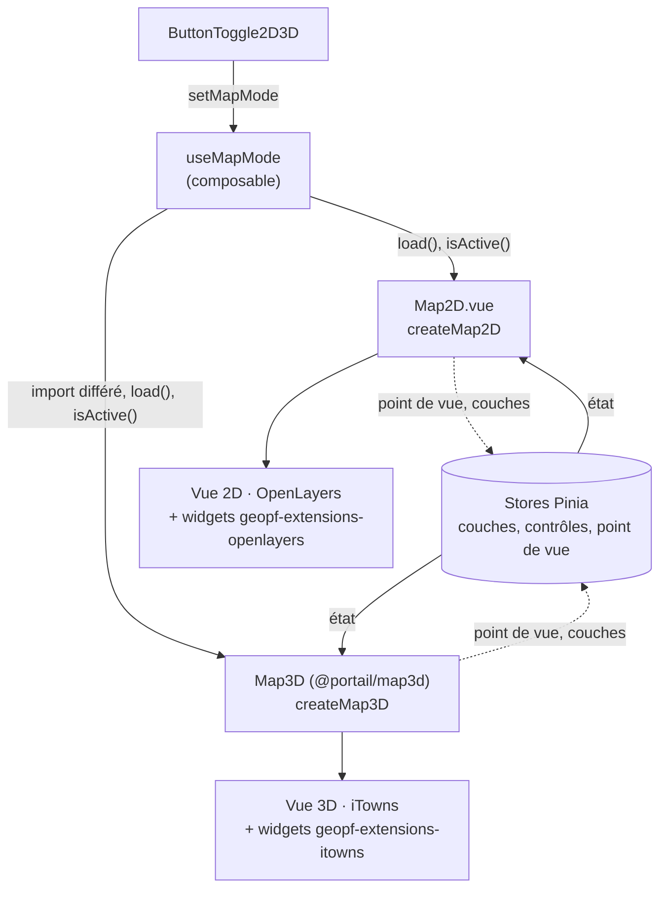
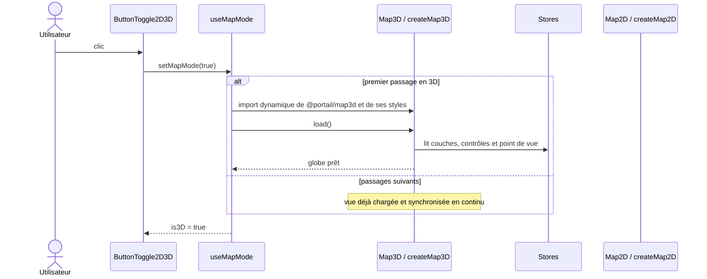

# Spécification — Intégration d’iTowns (vue 3D) dans cartes.gouv.fr-entree-carto

**Projet concerné :** cartes.gouv.fr-entree-carto (Vue 3, OpenLayers 10)

> Ce document suit le formalisme de la spécification de la librairie d’authentification Vue 3 : contexte, périmètre, exigences identifiées (FR / NFR), décisions d’architecture (ADR), questions ouvertes, historique. Les éléments marqués **\[À CONFIRMER\]** sont des hypothèses de travail à valider avant la v0.3.0. La v0.2.0 aligne la spécification sur l’expérimentation switch2d3d ; les écarts restants entre exigences et expérimentation sont signalés en italique.

## 1. Contexte et objectifs

### 1.1 Contexte

L’application cartes.gouv.fr-entree-carto affiche aujourd’hui ses cartes en 2D avec OpenLayers. La Géoplateforme (GPF) et l’écosystème Géoportail proposent par ailleurs iTowns, une librairie de visualisation 3D basée sur three.js, capable d’afficher un globe ou un plan 3D avec relief et couches géographiques.

L’objectif est d’offrir à l’utilisateur une vue 3D de sa carte, accessible depuis l’interface existante, sans rupture de contexte.

### 1.2 Objectifs

- Permettre de basculer de la 2D vers la 3D, et inversement, via un bouton toggle.
- Afficher en 3D les couches initialement présentes en 2D.
- Maintenir une synchronisation des couches entre les deux vues pendant toute la session.
- Conserver le point de vue (position, niveau de zoom) lors d’un changement de mode.
- Ne pas dégrader le temps de chargement initial pour les utilisateurs restant en 2D.

### 1.3 Non-objectifs

Voir section 2.2.

## 2. Périmètre

### 2.1 Dans le périmètre (v1)

- Un composant bouton toggle 2D / 3D intégré à l’interface cartographique.
- Une vue 3D iTowns instanciée à la demande (chargement différé), fournie par un composant indépendant, la bibliothèque `@portail/map3d` (voir ADR-005).
- La synchronisation des couches : ajout, suppression, visibilité, opacité, ordre.
- La synchronisation du point de vue lors du basculement.
- Le support des couches du catalogue, dans la limite de leur équivalent iTowns (voir FR-004).
- Des widgets équivalents dans les vues 2D et 3D, chaque carte disposant de ses propres instances : gestionnaire de couches, échelle graphique (scaleline), coordonnées sous le curseur, puis zoom, plein écran (fullscreen), minimap et d’autres widgets du même type (liste à arrêter, voir QO-008).
- Des widgets rendus en DSFR dans la webapp, quelle que soit la vue (voir NFR-010).
- Un point d’accès unique côté application, sous forme de composable `useMapMode` (voir ADR-002).

### 2.2 Hors périmètre (v1)

- Édition de données (dessin, modification d’entités) en 3D.
- Affichage simultané 2D + 3D côte à côte.
- Outils de mesure, prévus dans une version ultérieure.
- Bâtiments 3D, MNT personnalisés, 3D Tiles et autres jeux de données propres à la 3D **\[À CONFIRMER\]**.
- Exports (impression, capture) depuis la vue 3D.
- Remplacement d’OpenLayers par iTowns pour la vue 2D.
- Couches autres que celles du catalogue : données de l’espace personnel (favoris), imports provisoires (KML, GPX, GeoJSON) et croquis non enregistrés. Elles relèvent d’un autre périmètre, à prévoir (voir FR-004).
- Couches protégées nécessitant un jeton, à traiter dans un autre périmètre (voir FR-011).
- Partage du cache des tuiles entre les vues 2D et 3D : les deux moteurs utilisent des projections et des tuilages différents, ce qui rend les requêtes de tuiles distinctes (voir P-05 et P-10).

## 3. Glossaire

| Terme | Définition |
| --- | --- |
| Vue 2D | Carte OpenLayers existante (`ol/Map`). |
| Vue 3D | Vue iTowns (globe ou plan 3D) instanciée par l’application. |
| Mode | État courant d’affichage : `2d` ou `3d`. |
| Couche source | Descripteur de couche déclaré dans le store, indépendant du moteur de rendu (`id`, `type`, `visible`, `opacity`, `order`, `source`). |
| Contrôleur de carte | Fabrique (`createMap2D` pour OpenLayers, `createMap3D` pour iTowns) qui crée une carte à partir des stores et la tient synchronisée ; elle expose `load(target)` et `dispose()`. |
| `@portail/map3d` | Bibliothèque indépendante qui fournit la vue 3D iTowns : composant `Map3D`, composable `useMap3D` et contrôleur `createMap3D`. Elle ne possède ni état cartographique ni chargeur de catalogue. |
| Synchro | Mécanisme maintenant la cohérence des couches et du point de vue entre les deux vues. |

## 4. Architecture proposée

### 4.1 Principe

L’état cartographique (couches, contrôles, point de vue) est la **source de vérité unique**, indépendante du moteur de rendu. Il est porté par des stores Pinia de l’application (`layers`, `controls`, `map`), construits à partir des fabriques `createLayersState`, `createControlsState` et `createViewState`. Les deux vues sont des projections de cet état : chacune dispose d’un **contrôleur de carte** qui crée, met à jour et supprime ses propres objets natifs à partir des stores.



Les flèches pleines suivent la propagation de l’état ; les flèches pointillées remontent vers les stores les changements faits dans la vue active (navigation, gestionnaire de couches), pour que l’autre vue les reprenne (FR-005, FR-006).

**Le contrôleur de carte en détail.** Un contrôleur est la seule pièce qui connaît les objets natifs d’un moteur (OpenLayers ou iTowns). Il traduit l’état des stores en objets de rendu et remonte les changements de la vue active ; il ne porte aucun état métier.

**Responsabilités.**

- **Conversion** : transformer un descripteur de couche en couche native (voir 5.1) ; un type non supporté est journalisé et la couche n’est pas affichée (FR-009).
- **Réconciliation** : comparer l’état voulu et l’état affiché, puis n’appliquer que les différences (ajout, suppression, visibilité, opacité, ordre) ; l’opération est idempotente et un changement de source recrée la couche concernée (FR-005).
- **Registre** : conserver la correspondance entre l’identifiant d’une couche et son objet natif, et retirer les écouteurs à la suppression (NFR-009).
- **Point de vue** : appliquer le point de vue des stores et remonter celui de la vue active, avec la conversion de zoom propre au moteur (FR-006, R-004).
- **Contrôles** : instancier, sans doublon, les widgets de sa propre carte à partir de la liste partagée des contrôles (FR-013 à FR-016).
- **Cycle de vie** : charger la carte dans un élément cible, puis la détruire en libérant ses ressources (4.3, ADR-004).

**Règles.**

- Le contrôleur lit les stores ; il ne les modifie que pour remonter un changement fait dans sa vue, et seulement si sa vue est active (`isActive()`), ce qui évite les boucles de mise à jour.
- Aucun contrôleur ne connaît l’autre ; seul `useMapMode` orchestre leur chargement et leur activation.
- Les composants de l’application n’utilisent pas directement les contrôleurs : ils passent par les composants `Map2D` et `Map3D`, eux-mêmes pilotés par `useMapMode` (ADR-002, NFR-007).
- Une couche non supportée n’est pas affichée, mais reste dans le store.
- Les deux contrôleurs suivent les stores en continu, y compris pendant que leur vue est masquée ; la synchronisation différée de P-06 n’est pas mise en œuvre.

**Différences entre les deux contrôleurs.**

| Aspect | `createMap2D` (OpenLayers) | `createMap3D` (iTowns, `@portail/map3d`) |
| --- | --- | --- |
| Emplacement | Application (`src/features/createMap2D.js`) | Bibliothèque indépendante `@portail/map3d` |
| Objets de couche natifs | `LayerWMTS` (geopf-extensions-openlayers) | `GeopfWMTS` (couleur) et `GeopfElevation` (relief), geopf-extensions-itowns |
| Point de vue | Centre (EPSG:3857) et zoom | Centre (EPSG:4326), distance de caméra déduite du zoom 2D − 1 ; inclinaison initiale de 45° |
| Chargement | Au montage de la page, après le chargement de la configuration | Import dynamique au premier passage en 3D (ADR-003) |
| Cycle de vie | Carte conservée et masquée pendant la 3D | Vue conservée et masquée au retour en 2D (ADR-004) |

**Contrat du contrôleur.**

```typescript
interface MapControllerOptions {
  layers: LayersState      // réactif : layers2D / layers3D, descriptors2D / descriptors3D, addLayer, removeLayer, updateLayer
  controls: ControlsState  // réactif : controls2D / controls3D
  view: ViewState          // réactif : coordinates, zoom, setView()
  isActive?: () => boolean // la vue peut-elle remonter ses changements vers les stores ?
  controlTypes?: Record<string, ControlConstructor>
  // 2D : mapOptions ; 3D : globeOptions, elevationLayerId, attribution
}

interface MapController {
  load(target: HTMLElement): Promise<NativeMap>  // ol/Map ou GlobeViewExtended
  dispose(): void                                 // libère la carte, les watchers et les écouteurs
}
```

**Séquence d’un basculement vers la 3D.**



**Note over C2,C3**: la vue 2D est masquée (CSS) ; seule la vue 3D remonte ses changements

**À préciser.** Mise en œuvre de la synchronisation différée (P-06) et de la suspension de la vue masquée (P-01) ; découpage interne de chaque contrôleur par type de couche lorsque d’autres types seront supportés (voir 5.1).

### 4.2 Composants

- **ButtonToggle2D3D** : bouton de bascule (`role="switch"`), affiche le mode actif, accessible au clavier.
- **useMapMode** (composable) : charge la configuration du catalogue, puis la carte 2D ; charge la 3D à la demande ; expose le mode courant, `setMapMode()`, les états de chargement et les erreurs (voir 7).
- **Map2D** et **createMap2D** : composant et contrôleur de la vue OpenLayers, dans l’application.
- **Map3D**, **useMap3D** et **createMap3D** : composant, composable et contrôleur de la vue iTowns, fournis par `@portail/map3d`. Le composant émet `ready` et `error`, et expose `load()` et `dispose()`.
- **Stores Pinia** (`layers`, `controls`, `map`) : état partagé par les deux vues ; la couche de relief n’est ajoutée qu’à la vue 3D.

### 4.3 Cycle de vie de la vue 3D

1. Premier passage en 3D : import dynamique de `@portail/map3d` et de sa feuille de styles, montage du composant `Map3D`, création du globe, ajout des couches et des contrôles de l’état courant.
2. Retour en 2D : la vue 3D est masquée en CSS (opacité, visibilité, attribut `inert`) ; elle n’est ni suspendue ni détruite. Le globe, son contexte WebGL et ses watchers restent actifs ; elle continue de suivre les stores, sans remonter ses changements.
3. Passages suivants : affichage immédiat de la vue déjà à jour, sans rechargement.
4. Destruction : `dispose()` n’est appelé qu’au démontage du composant (sortie de la page). Il libère les watchers, les écouteurs, les widgets, la vue iTowns et le renderer three.js.

La vue 2D suit le même modèle : masquée pendant la 3D, elle reste chargée et suit les stores (point de vue et couches), et peut donc continuer à demander des tuiles.

## 5. Exigences fonctionnelles

| ID | Exigence | Priorité |
| --- | --- | --- |
| FR-001 | L’interface propose un bouton toggle permettant de passer de la vue 2D à la vue 3D et inversement. | Must |
| FR-002 | Le bouton indique clairement le mode actif et le mode cible, et fournit un libellé accessible (ARIA). | Must |
| FR-003 | Au premier passage en 3D, toutes les couches présentes en 2D sont affichées en 3D avec le même ordre, la même visibilité et la même opacité. | Must |
| FR-004 | Le type de couche géré est la couche du catalogue (WMTS de la Géoplateforme), associée à un équivalent 3D (voir 5.1). Les données de l’espace personnel (favoris), les imports provisoires (KML, GPX, GeoJSON) et les croquis non enregistrés ne sont pas gérés dans ce périmètre ; ils sont à prévoir dans un autre périmètre. | Must |
| FR-005 | Toute modification des couches (ajout, suppression, visibilité, opacité, ordre) effectuée dans un mode est répercutée dans l’autre. | Must |
| FR-006 | Le point de vue (centre, niveau de zoom équivalent) est conservé lors du changement de mode. | Must |
| FR-007 | Pendant le chargement de la 3D, l’utilisateur voit un indicateur ; la vue 2D reste utilisable jusqu’à la fin du chargement. | Should |
| FR-008 | Si la 3D ne peut pas être initialisée (WebGL indisponible, erreur de chargement), l’application reste en 2D et informe l’utilisateur. | Must |
| FR-009 | Les couches non supportées en 3D sont signalées à l’utilisateur et conservées dans l’état pour le retour en 2D. *Expérimentation : la couche n’est pas affichée et reste dans le store, mais l’erreur est seulement journalisée en console.* | Should |
| FR-010 | Le mode courant est persisté pour la session (et, éventuellement, reflété dans l’URL) **\[À CONFIRMER\]**. | Could |
| FR-011 | *Hors périmètre, reporté à un autre périmètre.* Les couches protégées nécessitant un jeton sont accessibles en 3D comme en 2D. | — |
| FR-012 | La vue 3D permet au minimum la navigation (déplacement, zoom, rotation, inclinaison) ; l’orientation de la caméra est restituée au retour en 2D selon QO-006. | Should |
| FR-013 | Les widgets de zoom et de plein écran sont disponibles et fonctionnels en 2D comme en 3D. *Expérimentation : non encore ajoutés ; les contrôles disponibles sont le gestionnaire de couches, l’échelle et les coordonnées sous le curseur.* | Must |
| FR-014 | Chaque carte dispose de son propre widget de gestion des couches (LayerSwitcher de geopf-extensions-openlayers en 2D, de geopf-extensions-itowns en 3D). Les deux widgets lisent et modifient le même store des couches (ajout, suppression, visibilité, opacité, ordre), conformément à FR-005. | Must |
| FR-015 | Les coordonnées sous le curseur sont affichées en 2D et en 3D, dans le même système de coordonnées (à confirmer, y compris l’altitude en 3D). | Should |
| FR-016 | L’échelle graphique (scaleline) et la minimap sont affichées dans les deux vues ; la minimap reste cohérente avec l’emprise courante après un changement de mode. *Expérimentation : l’échelle est disponible dans les deux vues ; la minimap ne l’est pas encore.* | Should |

### 5.1 Correspondance des types de couches

Seules les couches du catalogue sont gérées dans ce périmètre (FR-004). Les autres types relèvent d’un autre périmètre.

| Type de couche 2D | Équivalent iTowns | Statut v1 |
| --- | --- | --- |
| Couches du catalogue, WMTS de la Géoplateforme (`LayerWMTS`) | Couche couleur `GeopfWMTS` | Supporté |
| Relief (MNT Géoplateforme) | Couche d’élévation `GeopfElevation`, propre à la vue 3D | Supporté, actif par défaut en 3D (QO-005) |
| WMS | Couche couleur (source WMS) | À étudier |
| Tuiles vectorielles (WMTS / MVT) | Couche tuiles vectorielles | À étudier |
| WFS | Couche de features | À étudier |
| Données de l’espace personnel (favoris) | — | Hors périmètre, à prévoir dans un autre périmètre |
| Imports provisoires de données (KML, GPX, GeoJSON) | — | Hors périmètre, à prévoir dans un autre périmètre |
| Croquis non enregistrés | — | Hors périmètre, à prévoir dans un autre périmètre |

## 6. Exigences non fonctionnelles

| ID | Exigence |
| --- | --- |
| NFR-001 | **Performance** : iTowns et three.js sont chargés à la demande ; aucun surcoût significatif sur le bundle initial. |
| NFR-002 | **Performance** : le basculement 2D → 3D est perçu comme fluide après le premier chargement (objectif chiffré à définir). |
| NFR-003 | **Compatibilité** : support des navigateurs ciblés par le projet (browserslist, dont Safari 16) ; comportement dégradé documenté si WebGL est insuffisant. |
| NFR-004 | **Sécurité** : les données géographiques importées restent assainies avant affichage, quel que soit le moteur de rendu (cf. politique XSS existante). |
| NFR-005 | **Sécurité** : *hors périmètre, avec FR-011.* Les jetons ne sont jamais exposés dans les URL de couches ; la méthode d’injection du jeton dans les requêtes iTowns est identique en principe à celle utilisée en 2D. |
| NFR-006 | **Accessibilité** : le bouton toggle respecte le DSFR et les critères RGAA applicables ; la vue 3D est documentée comme non conforme si nécessaire. |
| NFR-007 | **Maintenabilité** : le code iTowns est isolé dans la bibliothèque indépendante `@portail/map3d` (ADR-005) ; l’application n’importe ni iTowns ni three.js, et ses composants ne manipulent pas directement les objets iTowns. |
| NFR-008 | **Testabilité** : le composable ne porte pas d’état global, chaque instance étant indépendante, et les contrôleurs sont injectables (mock) dans les tests unitaires ; tests E2E Playwright (Chromium, Firefox, WebKit) du basculement. |
| NFR-009 | **Mémoire** : pas de fuite lors de bascules répétées (libération des ressources three.js). |
| NFR-010 | **Interface** : tous les widgets (toggle, zoom, plein écran, gestionnaire de couches, coordonnées, échelle, minimap) sont présentés en DSFR, avec un rendu et un comportement identiques en 2D et en 3D ; les widgets proviennent de geopf-extensions-itowns (DSFR) et, à défaut, les widgets natifs d’iTowns sont stylés ou remplacés en conséquence. |

## 7. Interface du composable

Interface mise en œuvre par l’expérimentation :

```typescript
function useMapMode(options: {
  layers: LayersState
  controls: ControlsState
  view: ViewState
  elevationLayerId?: string
}): {
  map2dRef: Ref<Map2DInstance | null>       // composant Map2D (load, dispose)
  map3dRef: Ref<Map3DInstance | null>       // composant Map3D de @portail/map3d (load, dispose)
  map3DComponent: ShallowRef<Component | null> // composant Map3D, défini après l’import différé
  options2D: MapControllerOptions           // options transmises à Map2D, avec isActive()
  options3D: MapControllerOptions           // options transmises à Map3D, avec isActive()
  is3D: Ref<boolean>
  isReady2D: Ref<boolean>
  isReady3D: Ref<boolean>
  isLoading2D: Ref<boolean>
  isLoading3D: Ref<boolean>
  isLoading: ComputedRef<boolean>
  canToggle: ComputedRef<boolean>           // 2D prête et aucun chargement en cours
  loadingError: Ref<string | null>          // message affichable à l’utilisateur
  setMapMode(is3D: boolean): Promise<void>
}
```

La vue 3D est montée dans un conteneur distinct, superposé à la vue 2D ; la vue masquée reçoit `visibility: hidden`, `inert` et `aria-hidden`. Les stores sont transmis aux contrôleurs par les options du composant (`options2D`, `options3D`). La détection préalable du support de WebGL (`isSupported3D`) n’est pas mise en œuvre : un échec de chargement est signalé par `loadingError`, et l’utilisateur reste en 2D (FR-008).

## 8. Décisions d’architecture (ADR)

### ADR-001 — État cartographique indépendant du moteur de rendu *(acceptée)*

**Décision :** les couches, les contrôles et le point de vue sont décrits dans des stores Pinia ; OpenLayers et iTowns en sont des projections via leurs contrôleurs de carte (`createMap2D`, `createMap3D`).\
**Raison :** évite la double source de vérité et rend la synchro (FR-005) déterministe.\
**Conséquence :** le code existant qui lit directement les couches OpenLayers doit être migré vers le store.\
**Alternative écartée :** synchronisation par événements entre les deux moteurs, fragile et sujette aux boucles de mise à jour.

### ADR-002 — Composable comme point d’accès unique *(acceptée)*

**Décision :** l’accès au mode 2D / 3D passe uniquement par un composable (`useMapMode`), dans la continuité du choix fait pour la librairie d’authentification.\
**Conséquence :** l’application n’importe jamais iTowns directement.

### ADR-003 — Chargement différé d’iTowns *(acceptée)*

**Décision :** `@portail/map3d` (et donc iTowns et three.js) ainsi que sa feuille de styles sont importés dynamiquement au premier passage en 3D.\
**Raison :** NFR-001.

### ADR-004 — Vue 3D conservée au retour en 2D *(acceptée)*

**Décision :** une fois chargée, la vue 3D est conservée et masquée au retour en 2D ; elle n’est détruite qu’au démontage de la page. La vue 2D est elle aussi conservée et masquée pendant la 3D.\
**Raison :** bascules suivantes instantanées, sans rechargement ni perte de l’état des widgets.\
**Conséquence :** aucune ressource n’est libérée à la bascule ; les deux moteurs, et leurs contextes graphiques, restent en mémoire (scénario D de 11.2). La suspension de la vue masquée (P-01) et la libération différée (P-08) restent des pistes.

### ADR-005 — Vue 3D fournie par un composant indépendant *(acceptée)*

**Décision :** la vue 3D est fournie par la bibliothèque `@portail/map3d`, qui exporte le composant `Map3D`, le composable `useMap3D` et le contrôleur `createMap3D`, ainsi que sa feuille de styles (`@portail/map3d/style.css`).\
**Raison :** isoler iTowns, three.js et geopf-extensions-itowns du reste de l’application (NFR-007), et permettre la réutilisation de la vue 3D dans d’autres applications.\
**Conséquence :** la bibliothèque ne possède ni état cartographique ni chargeur de catalogue : l’application hôte fournit les stores réactifs et initialise le catalogue de la Géoplateforme. Le code de la bibliothèque n’utilise que des imports relatifs, pour pouvoir être consommé depuis ses sources.

## 9. Risques

| ID | Risque | Mitigation envisagée |
| --- | --- | --- |
| R-001 | Écarts de rendu des styles vectoriels entre OpenLayers et iTowns. | Limiter la v1 aux couches raster ; table de conversion de styles pour la suite. |
| R-002 | Compatibilité WebGL (Safari, appareils modestes), déjà sensible avec OpenLayers 10. | Détection de capacité, repli en 2D (FR-008), tests WebKit. |
| R-003 | Poids du bundle (three.js + iTowns). | Chargement différé (ADR-003), mesure en CI. |
| R-004 | Différences de projection et de niveaux de zoom entre les deux moteurs, d’où dérive du point de vue. | Tests de non-régression sur la conversion du point de vue. |
| R-005 | Authentification des couches protégées côté iTowns. | Hors périmètre (FR-011) ; prototype dédié dans le périmètre concerné. |
| R-006 | Fuites mémoire lors de bascules répétées. | NFR-009, tests de charge manuels. |
| R-007 | iTowns n’implémente pas nativement le DSFR : les widgets natifs non couverts par geopf-extensions-itowns créent une incohérence visuelle et d’accessibilité avec le reste de l’interface. | S’appuyer sur geopf-extensions-itowns, qui gère le DSFR ; pour les widgets restants (scaleline, plein écran), les styler en DSFR ou les remplacer par des composants Vue DSFR (NFR-010). |

## 10. Questions ouvertes

| ID | Question | Bloquante |
| --- | --- | --- |
| QO-001 | Quelle version d’iTowns cibler, et quelle compatibilité avec la version de three.js déjà présente dans l’écosystème GPF ? *Expérimentation : iTowns 2.38.2 et three.js 0.137.5, imposés par geopf-extensions-itowns.* | Oui |
| QO-002 | geopf-extensions-itowns gère le DSFR et fournit le gestionnaire de couches, les coordonnées de la souris, la minimap et le zoom (ces deux derniers peut-être hérités des widgets natifs d’iTowns, à confirmer). Restent à vérifier : la couverture de la scaleline et du plein écran, et la version d’iTowns compatible. | Oui |
| QO-003 | Quels types de couches doivent absolument être supportés en 3D dès la v1 ? *Réponse : les couches du catalogue (FR-004, 5.1).* | Non |
| QO-004 | Vue 3D conservée en mémoire ou détruite au retour en 2D ? *Réponse : conservée (ADR-004).* | Non |
| QO-005 | Un relief (MNT Géoplateforme) est-il activé par défaut en 3D ? *Expérimentation : oui, la couche d’élévation est ajoutée par défaut à la seule vue 3D.* | Non |
| QO-006 | Comment restituer l’inclinaison et l’orientation de la caméra 3D au retour en 2D ? *Expérimentation : seuls le centre et le zoom sont synchronisés ; l’inclinaison et le cap ne sont pas restitués.* | Non |
| QO-007 | Le mode doit-il être partagé dans les URL de partage de carte ? | Non |
| QO-008 | Quels widgets 2D existants (recherche, mesures, légende…) doivent être disponibles en 3D ? | Oui |
| QO-009 | Quelle exigence de conformité (RGAA, sécurité) s’applique à la vue 3D ? | Non |

## 11. Pistes exploratoires — fluidité du basculement 2D / 3D

*Section exploratoire : rien n’est décidé. OpenLayers et iTowns sont deux moteurs lourds pour le navigateur ; chaque piste ci-dessous appelle un choix à trancher avant la v0.3.0, idéalement après mesure sur un appareil modeste et sous Safari. Les valeurs données sont indicatives.*

| ID | Piste | Choix à faire | Liens |
| --- | --- | --- | --- |
| P-01 | **Un seul moteur actif à la fois.** *Non mise en œuvre dans l’expérimentation : les deux vues restent chargées et synchronisées, la vue inactive étant seulement masquée en CSS (4.3).* La carte OpenLayers est masquée sans être détruite (`updateSize()` au retour) et ne charge plus de tuiles pendant la 3D ; la vue iTowns est suspendue en 2D. | Suspendre le rendu de la vue inactive ou la détruire ; vérifier comment suspendre la boucle de rendu d’iTowns. | ADR-004, NFR-009 |
| P-02 | **Contextes WebGL.** Un seul contexte actif ; gestion de `webglcontextlost` avec repli en 2D ; détection de capacité (WebGL2, `navigator.deviceMemory` sous Chromium) pour proposer ou non la 3D. | Seuils de repli et message affiché à l’utilisateur. | FR-008, R-002 |
| P-03 | **Préchargement d’iTowns.** Au survol ou au focus du bouton, ou en `requestIdleCallback` après le premier affichage ; chunk dédié pour three.js et iTowns, servi en brotli ; initialisation découpée en petites tâches. | Déclencheur du préchargement (aucun, survol, inactivité) et coût en bande passante. | ADR-003, NFR-001 |
| P-04 | **Masquer la latence.** La 2D reste interactive pendant le chargement, puis fondu enchaîné ; caméra 3D qui démarre à la verticale, calée sur l’emprise 2D, puis s’incline progressivement. | Type de transition : coupure, fondu ou animation de caméra. | FR-006, FR-007 |
| P-05 | ~~**Réutiliser le cache HTTP.**~~ *Abandonnée* : OpenLayers et iTowns n’utilisent pas la même projection ni le même tuilage ; les tuiles demandées par les deux moteurs diffèrent, et le cache HTTP n’est donc pas partagé entre les vues 2D et 3D. Chaque moteur bénéficie seulement de son propre cache lors des bascules suivantes. | — | P-10 à P-12, 11.4 |
| P-06 | **Synchronisation à la demande.** *Non mise en œuvre dans l’expérimentation : les deux contrôleurs suivent les stores en continu (4.1).* Seule la vue visible est mise à jour ; au basculement, les différences accumulées sont appliquées en un lot ; parsing des gros imports (KML, GPX, GeoJSON) dans un Web Worker. | Synchro continue ou différée ; périmètre du Web Worker. | ADR-001, FR-005 |
| P-07 | **Rendu 3D allégé.** `pixelRatio` plafonné (autour de 1,5 à 2), antialiasing désactivé sur mobile, erreur d’écran tolérée et niveau maximal de tuiles réglés, imagerie chargée avant le relief. | Valeurs par défaut ; relief activé d’emblée ou différé. | QO-005, NFR-002 |
| P-08 | **Gestion de la mémoire.** *Non mise en œuvre dans l’expérimentation : la vue 3D n’est libérée (`dispose()`) qu’au démontage de la page.* Vue 3D conservée puis libérée après un délai d’inactivité (`dispose()`, `forceContextLoss()`) ; test de bascules répétées. | Délai d’inactivité ; politique conserver ou détruire (ADR-004). | ADR-004, NFR-009 |
| P-09 | **Mesure.** `performance.mark` autour du chargement, de la création de la vue et de la synchronisation des couches ; budgets chiffrés. | Budgets à fixer (temps de bascule à chaud, premier affichage 3D) et appareils de référence. | NFR-002, NFR-003 |
| P-10 | ~~**Cache HTTP partagé entre OpenLayers et iTowns.**~~ *Abandonnée* : un constructeur d’URL unique ne peut pas fonctionner, car les deux cartes n’utilisent pas la même projection ni le même TileMatrixSet ; les tuiles demandées sont différentes. Restent utiles, pour chaque moteur pris isolément : même mode CORS (crossOrigin anonymous) et en-têtes Cache-Control et ETag corrects côté serveur, sans Vary inutile. | En-têtes à demander à la Géoplateforme. | P-05, 11.2 |
| P-11 | **Préchauffage des tuiles.** Le cache n’étant pas partagé entre les deux moteurs (P-05), le préchauffage doit cibler le tuilage propre à iTowns. Calculer les tuiles que la 3D va demander pour l’emprise courante et les télécharger avant ou pendant la transition. | Activer ou non ; coût en bande passante (tuiles inutiles) ; sens 2D vers 3D seulement ou dans les deux sens. | P-04, P-05 |
| P-12 | **Service Worker avec API Cache.** *Ne permet pas de mutualiser les tuiles 2D et 3D (P-05) ; ne sert qu’à améliorer le cache propre à chaque moteur.* Normalisation des URL, stratégie « périmé pendant revalidation », durée de vie maîtrisée indépendamment des en-têtes du serveur. | Complexité (portée, mises à jour, jetons) acceptable ou non ; à n’envisager que si P-10 ne suffit pas. | P-10, FR-011 |

Les choix retenus seront reportés dans les ADR, les exigences non fonctionnelles et les exigences fonctionnelles correspondantes.

### 11.1 Poids du code JavaScript : OpenLayers (2D) et iTowns (3D)

*Mesure réalisée le 17 octobre 2026 avec esbuild (bundle ESM minifié) sur les dernières versions publiées sur npm, en isolation du reste de l’application. 1 Ko = 1 000 octets.*

| Ensemble | Contenu mesuré | Minifié | gzip | brotli |
| --- | --- | --- | --- | --- |
| OpenLayers 10.11.0 | Map, View, couches tuilées et vectorielles, sources WMTS et WMS, formats GeoJSON / KML / GPX, contrôles zoom, échelle, plein écran, position de la souris, vue d’ensemble | 401 Ko | 116 Ko | 99 Ko |
| iTowns 2.46.0, imports ciblés | GlobeView, Extent, couches couleur et élévation, sources WMTS / WMS / fichier, Fetcher ; inclut la part de three.js réellement utilisée | 1 317 Ko | 369 Ko | 306 Ko |
| iTowns 2.46.0, import complet | Tout l’export de la librairie, sans tree-shaking | 1 677 Ko | 482 Ko | 398 Ko |

**Lecture.**

- Le code iTowns pèse environ trois fois celui d’OpenLayers (≈ 3,3 fois en minifié, ≈ 3,1 fois en brotli) pour un jeu de fonctionnalités équivalent à ce qui est utilisé en 2D.
- Le surcoût d’un premier passage en 3D est de l’ordre de 300 Ko compressés en brotli (≈ 370 Ko en gzip), à comparer aux ≈ 100 Ko de la 2D. Cela justifie le chargement différé (ADR-003) et le préchargement (P-03).
- Les imports ciblés économisent environ 20 % par rapport à l’import complet : les imports doivent rester nominatifs (P-03).
- iTowns 2.46.0 déclare une dépendance de pair sur three.js en `^0.174.0`, alors que la dernière version de three.js publiée est plus récente (0.186.x). L’installation avec la dernière version de three.js échoue : à vérifier avec QO-001, et à surveiller si l’application utilise déjà three.js.

**Limites de cette mesure.**

- Elle ne couvre ni geopf-extensions-itowns (introuvable sous ce nom sur le registre npm public, à mesurer depuis ses sources), ni les extensions OpenLayers de la Géoplateforme, ni vue-dsfr.
- Elle ne mesure que le code : les tuiles, textures, relief et la mémoire GPU consommés à l’exécution sont à mesurer dans le navigateur (onglets Network et Performance, `performance.mark`) pour alimenter NFR-002 et P-09.
- Les budgets chiffrés restent à fixer (P-09) ; ces valeurs en sont le point de départ.

### 11.2 Empreinte mémoire dans le navigateur : carte 2D et carte 3D

*Section exploratoire. Les valeurs ci-dessous sont des **estimations par le calcul**, à partir d’hypothèses explicites ; elles n’ont pas été mesurées dans un navigateur. Elles servent à repérer les postes dominants et à définir le protocole de mesure. 1 Mio = 1 048 576 octets.*

**Hypothèses de calcul.** Écran de 1920 × 1080 pixels CSS ; tuiles raster de 256 × 256 pixels, 4 octets par pixel une fois décodées ; une couche raster visible ; rapport de pixels (DPR) de 1, puis de 2.

| Poste | Calcul | Ordre de grandeur |
| --- | --- | --- |
| Tampon de dessin, DPR 1 | 1920 × 1080 × 4 o | ≈ 8 Mio en 2D (canvas) ; ≈ 16 Mio en 3D (couleur + profondeur 32 bits) |
| Tampon de dessin, DPR 2 | × 4 par rapport au DPR 1 | ≈ 32 Mio en 2D ; ≈ 63 Mio en 3D |
| Antialiasing multi-échantillons (MSAA ×4) en 3D | × 4 sur la couleur et la profondeur | jusqu’à ≈ 63 Mio (DPR 1) et ≈ 253 Mio (DPR 2), selon le pilote graphique |
| Tuiles raster affichées, par couche | 9 × 6 = 54 tuiles × 256 × 256 × 4 o | ≈ 13,5 Mio en 2D |
| Textures de tuiles du globe, par couche | 150 tuiles (hypothèse) × 256 × 256 × 4 o × 1,33 (mipmaps) | ≈ 50 Mio en 3D |
| Relief (QO-005) | textures d’élévation en plus de l’imagerie | À mesurer |
| Code JavaScript chargé | 99 Ko (OpenLayers) contre 306 Ko (iTowns) en brotli, soit nettement plus une fois décompressé et compilé | À mesurer |

**Lecture.**

- Le poste dominant est le **tampon de dessin** : il croît avec la surface de l’écran, le carré du DPR et, en 3D, l’antialiasing. Plafonner le `pixelRatio` et désactiver l’antialiasing (P-07) sont les leviers les plus efficaces.
- La 3D consomme plusieurs fois la mémoire de la 2D pour la même carte : tampon plus gros, textures GPU avec mipmaps, couche de profondeur, et plus de tuiles en mémoire simultanément.
- Garder les deux vues actives s’additionne et double le nombre de contextes graphiques (P-01, P-02) ; c’est le scénario à éviter, en particulier sur mobile.
- Chaque couche raster ajoutée en 3D coûte de l’ordre de la dizaine de Mio ; les couches vectorielles dépendent du nombre d’entités (imports KML, GPX, GeoJSON, croquis non enregistrés).
- Les limites de mémoire des onglets varient fortement selon l’appareil et le navigateur, et ne sont pas documentées de façon fiable : les budgets doivent être fixés à partir de mesures sur les appareils de référence (P-09).

**Protocole de mesure proposé.**

| Scénario | Mesures |
| --- | --- |
| A. 2D seule, après chargement | Tas JavaScript, mémoire GPU, mémoire du processus |
| B. 3D seule, après chargement | Idem, plus nombre de contextes WebGL |
| C. Après 10 bascules 2D ↔ 3D | Évolution par rapport à A et B (recherche de fuites, NFR-009) |
| D. 2D et 3D actives en même temps | Idem ; sert de référence haute |
| E. Après libération de la vue 3D (`dispose()`) | Mémoire récupérée |

Outils : gestionnaire de tâches de Chrome (empreinte mémoire, GPU), onglet Mémoire des DevTools (instantanés du tas), `performance.measureUserAgentSpecificMemory()` si l’isolation cross-origin le permet, inspecteur Web de Safari. Appareils : un poste de bureau, un portable d’entrée de gamme, un mobile iOS et un mobile Android.

**Choix à faire.** Plafond de `pixelRatio` et antialiasing par défaut ; taille des caches de tuiles côté OpenLayers et côté iTowns ; nombre maximal de couches raster en 3D ; budgets de mémoire par scénario et par appareil ; seuil au-delà duquel la 3D n’est plus proposée (P-02). Les choix retenus alimenteront NFR-002, NFR-009 et ADR-004.

### 11.3 Références : implémentations 2D / 3D existantes

*Références consultées le 18 octobre 2026, à partir de leur documentation publique. Aucune n’a été testée dans le cadre de cette spécification ; elles servent à s’inspirer de solutions éprouvées et à repérer leurs limites.*

| Référence | Approche | Enseignements pour entree-carto |
| --- | --- | --- |
| **SDK Web Géoplateforme 2D/3D** ([IGNF/geoportal-sdk](https://github.com/IGNF/geoportal-sdk), [documentation](https://geoservices.ign.fr/node/497), [paquet npm sdk-3d](https://www.npmjs.com/package/@ignf-geoportal/sdk-3d)) | OpenLayers pour la 2D, iTowns pour la 3D, avec les extensions Géoplateforme de chaque bibliothèque. Le mode est choisi par l’option `viewMode` (`"2d"` par défaut, ou `"3d"`), et la documentation annonce une bascule entre 2D et 3D. Le code d’une copie de test du paquet décrit une bascule qui recharge la carte avec l’autre bibliothèque en conservant projection, centre, inclinaison, azimut, zoom, couches et contrôles. | Référence prioritaire : même écosystème (OpenLayers, iTowns, extensions Géoplateforme) et même équipe de maintenance. Elle illustre le modèle « recharger la carte à chaque bascule », à comparer avec le modèle « vue 3D conservée » (ADR-004, P-01). Le détail de la bascule est à vérifier dans le dépôt officiel, la source consultée étant une copie de test. |
| **ol-cesium (OLCS)** ([dépôt](https://github.com/openlayers/ol-cesium), [documentation](https://openlayers.org/ol-cesium), [paquet npm olcs](https://www.npmjs.com/package/olcs)) | Ajoute un globe CesiumJS à une carte OpenLayers existante ; `setEnabled(true)` affiche la 3D, `setEnabled(false)` revient à la 2D. Synchronise le contexte de carte (emprise, zoom), les sources raster et vecteur, et la sélection. | Chargement de Cesium immédiat ou différé, et limitation de la consommation de ressources par détection d’inactivité : à rapprocher de P-03 et P-08. Limites documentées : les couches OpenLayers non « découvrables » ne sont pas supportées, et les interactions OpenLayers ne fonctionnent pas en 3D (à anticiper pour FR-009). Utilise CesiumJS et non iTowns : à titre d’inspiration uniquement. |
| **ArcGIS Maps SDK for JavaScript**, exemple « Switch between 2D and 3D » ([documentation](https://developers.arcgis.com/javascript/latest/sample-code/views-switch-2d-3d/index.html)) | Une carte 2D (arcgis-map) et une scène 3D (arcgis-scene) sont superposées ; le point de vue (centre, échelle, orientation) est copié de l’une à l’autre et un fondu enchaîné affiche la vue de destination. Deux autres approches sont décrites : voir la discussion ci-dessous. | Limites décrites par l’éditeur : certains types de couches n’existent pas dans l’autre mode, les symboles 3D ne sont pas tous affichables en 2D, et, avec la réaffectation de conteneur, les widgets sont détruits puis recréés à chaque bascule sauf s’ils sont préservés à la main. Confirme la nécessité de widgets communs (FR-013 à FR-016) pilotés par un état partagé. |
| **CesiumJS**, modes de scène 2D / 3D / vue Colomb ([documentation du sélecteur de mode](https://cesium.com/learn/cesiumjs/ref-doc/SceneModePickerViewModel.html)) | Moteur unique avec plusieurs modes d’affichage ; la transition est une animation (`morphTo2D`, `morphTo3D`) de durée réglable, une durée nulle donnant un changement instantané. | Architecture différente (un seul moteur) donc non transposable telle quelle, mais bon exemple de transition animée entre 2D et 3D (P-04). |

**Discussion : la bascule 2D / 3D de l’exemple ArcGIS.** L’exemple (page consultée le 18 octobre 2026) décrit trois façons de réaliser la bascule entre une carte 2D et une scène 3D, avec leurs compromis.

| Approche | Principe | Avantages | Inconvénients |
| --- | --- | --- | --- |
| **Composants superposés** (approche retenue par l’exemple) | Les deux composants sont dans la page, positionnés l’un sur l’autre ; la vue de destination apparaît par un fondu (opacité et visibilité) et reçoit une copie du point de vue. | Transition personnalisable ; widgets et superpositions restent actifs dans chaque composant ; la vue cible est déjà initialisée et disponible immédiatement. | Utilisation du GPU plus élevée, car les deux composants sont actifs. |
| **Composants superposés, masqués par l’attribut `hidden`** (variante) | Même principe, mais l’attribut `hidden` remplace la visibilité CSS. | Une seule vue rendue à la fois, donc moins de GPU ; les deux restent en mémoire et la bascule est instantanée. | Les deux vues occupent toujours la mémoire. |
| **Réaffectation de conteneur** | Un seul élément hôte : le conteneur est affecté à la vue active et retiré de l’autre. | Empreinte mémoire plus faible, une seule vue rendue ; moins de contextes WebGL. | Widgets et interface détruits puis recréés à chaque bascule sauf préservation manuelle ; pas de fondu intégré ; bref scintillement à l’initialisation ; code plus complexe. |

L’exemple recommande les composants superposés si la fluidité et la conservation de l’état de l’interface priment, la variante `hidden` si le GPU est un souci, et la réaffectation de conteneur si l’efficacité des ressources sur appareils contraints prime.

**Points techniques à retenir.**

- **Correction d’échelle en Web Mercator.** L’échelle apparente d’une carte Web Mercator augmente avec la latitude. L’exemple multiplie l’échelle par cos(latitude) en passant de la 2D à la 3D, et la divise en sens inverse, pour que la distance perçue au sol reste la même. À reprendre pour FR-006 et R-004 (dérive du point de vue entre OpenLayers en EPSG:3857 et iTowns).
- **Attendre que les deux vues soient prêtes** (`viewOnReady`) avant la première bascule : équivalent de notre chargement différé et de l’indicateur de chargement (FR-007).
- **Types de couches.** Les couches purement 3D sont retirées ou remplacées par une contrepartie 2D, et le relief est ignoré en 2D : à rapprocher du tableau 5.1 et de FR-009. Les symboles 3D ne sont pas pris en charge en 2D, ce qui renvoie à la conversion des styles (R-001).

**Mise en regard avec entree-carto.**

- Les trois approches correspondent aux options de P-01 et d’ADR-004 : composants superposés, les deux vues vivantes (scénario D de 11.2, référence haute de mémoire) ; variante `hidden`, vue inactive suspendue mais conservée ; réaffectation de conteneur, plus proche du modèle « recréer la vue » du SDK Géoplateforme. L’expérimentation retient les composants superposés, avec un fondu de 300 ms et `visibility: hidden` sur la vue masquée : les deux vues restent vivantes (ADR-004).
- ArcGIS fournit les deux vues dans un même SDK, avec un point de vue et des widgets partagés. Chez nous, OpenLayers et iTowns sont deux bibliothèques distinctes : point de vue et couches passent par nos stores et nos contrôleurs de carte (ADR-001), et chaque carte a ses propres widgets (FR-014).
- Le fondu CSS de l’exemple (400 ms) est un moyen simple de masquer la latence (P-04).
- Les avantages et inconvénients ci-dessus viennent de la documentation de l’éditeur ; ils n’ont pas été mesurés pour notre application.

**Choix à faire.** Approche de bascule retenue (superposée, superposée masquée, réaffectation), au regard des budgets mesurés (T-07 et scénarios A à E de 11.2) ; formule de conversion d’échelle à valider avec iTowns.

**Synthèse.**

- Deux familles d’architecture apparaissent : **deux moteurs synchronisés** (SDK Géoplateforme, ol-cesium, ArcGIS) et **un moteur unique à plusieurs modes** (CesiumJS). La spécification retient la première famille, comme le SDK Géoplateforme, ce qui rend les points de synchronisation (couches, point de vue, widgets) centraux.
- Les limites rencontrées par ces solutions se retrouvent dans cette spécification : types de couches non équivalents (5.1), interactions et widgets liés à une vue (FR-013 à FR-016), consommation de ressources (11.1, 11.2).

**Choix à faire.** Reprendre ou s’inspirer du code de bascule et de synchronisation du SDK Géoplateforme, ou développer des contrôleurs propres à l’application (choix retenu par l’expérimentation, ADR-001 et ADR-005) ; modèle de bascule : l’expérimentation conserve les deux vues, superposées (ADR-004) ; vérifier la maintenance et la licence du code du SDK avant toute réutilisation.

### 11.4 Tests de validation des pistes de cache

*L’expérimentation a infirmé le partage du cache entre les deux moteurs (P-05, P-10) : les projections et les tuilages diffèrent. T-01, T-03 et T-06 sont donc sans objet ; les autres tests restent utiles pour le cache propre à chaque moteur (bascules successives) et pour P-11 et P-12. Ils sont à réaliser sur le même jeu de couches WMTS de la Géoplateforme, avec un profil de navigateur vierge puis à chaud. Les résultats chiffrés alimenteront NFR-002 et P-09.*

| ID | Test | Méthode | Critère de décision |
| --- | --- | --- | --- |
| T-01 | **Recouvrement des tuiles 2D / 3D** *(sans objet)* | Charger la même carte (mêmes couches, même emprise) en 2D puis en 3D ; exporter chaque session en fichier HAR ; comparer les URL de tuiles. | Taux de tuiles 3D déjà demandées en 2D. Faible : traiter P-10 et P-11 ; élevé : P-10 suffit probablement. |
| T-02 | **Origine des réponses à la bascule** | Dans les DevTools (colonne Taille) ou via `performance.getEntriesByType('resource')` : un `transferSize` à 0 indique une réponse servie par le cache. | Part des tuiles servies par le cache lors des bascules 2D → 3D puis 3D → 2D. |
| T-03 | **Identité des URL générées** *(sans objet)* | Test unitaire : pour une même tuile, comparer l’URL construite par OpenLayers et celle construite par iTowns (ordre des paramètres, STYLE, FORMAT, clé, TileMatrixSet). | URL strictement identiques ; sinon écart à corriger par le constructeur d’URL unique (P-10). |
| T-04 | **CORS et mode de requête** | Charger une tuile en 2D avec `crossOrigin: 'anonymous'`, puis en 3D ; vérifier l’absence d’erreur CORS en console et la réutilisation du cache ; vérifier le mode de requête réellement utilisé par iTowns. | Aucune erreur et cache réutilisé. |
| T-05 | **En-têtes de cache du serveur** | Inspecter `Cache-Control`, `ETag`, `Expires` et `Vary` des tuiles (`curl -I` ou onglet Réseau). | Durée de vie suffisante et pas de `Vary` fragmentant ; sinon demande d’ajustement au service. |
| T-06 | **Couches protégées** *(sans objet)* | Répéter T-01 et T-02 avec une couche protégée par jeton Bearer. | Taux de cache comparable aux couches publiques ; sinon traiter le cas à part (FR-011). |
| T-07 | **Temps de bascule avec et sans cache** | `performance.mark` autour de la bascule ; mesure à froid (cache désactivé ou profil vierge), puis à chaud ; réseau bridé (Slow 4G) et appareil modeste, Safari compris. | Gain en millisecondes entre froid et chaud ; objectif à fixer dans NFR-002. |
| T-08 | **Préchauffage (prototype de P-11)** | Télécharger les tuiles calculées avant la transition ; mesurer le temps jusqu’au rendu 3D complet et la bande passante supplémentaire. | Gain de temps significatif pour un surcoût de bande passante acceptable. |
| T-09 | **Service Worker (prototype de P-12)** | Stratégie « périmé pendant revalidation » sur les tuiles ; comparer taux de cache, temps de bascule et complexité par rapport à P-10 seul. | Gain net par rapport à P-10 qui justifie la complexité. |
| T-10 | **Part non réductible par le cache** | Cache chaud, mesurer le temps CPU de décodage et d’envoi des textures à la bascule (onglet Performance, tâches longues) et la mémoire (11.2). | Confirme que le cache ne réduit que le réseau ; sert à dimensionner P-01, P-07 et P-08. |

**Ordre d’exécution proposé.** T-02 d’abord (peu coûteux), puis T-04 et T-05, puis T-07 pour chiffrer le gain. Les prototypes T-08 et T-09 ne sont à réaliser que si les résultats précédents le justifient. T-10 peut être mené en parallèle.

**Choix à faire.** Seuils de décision (taux de recouvrement, gain minimal), appareils et réseaux de référence, personne en charge des tests.

## 12. Prochaines étapes

1. Valider le périmètre révisé (couches du catalogue uniquement) et les questions bloquantes restantes avec l’équipe.
2. Combler les écarts signalés entre exigences et expérimentation : signalement des couches non supportées (FR-009), widgets de zoom, plein écran et minimap (FR-013, FR-016).
3. Mesurer la mémoire et les temps de bascule (11.2, T-07), puis décider de mettre en œuvre P-01, P-06 ou P-08.
4. Définir les périmètres suivants : favoris, imports provisoires et croquis (FR-004), couches protégées (FR-011).

## 13. Historique des versions

| Version | Date | Auteur | Changements |
| --- | --- | --- | --- |
| 0.1.0 | 2026-10-17 | JP | Ébauche initiale. |
| 0.2.0 | 2026-11-14 | JP | Alignement sur l’expérimentation : vue 3D fournie par `@portail/map3d` (ADR-005) ; adaptateurs remplacés par les contrôleurs `createMap2D` / `createMap3D` ; vue 3D conservée au retour en 2D (ADR-004) ; FR-004 restreinte aux couches du catalogue ; FR-011 hors périmètre ; un gestionnaire de couches par carte (FR-014) ; partage du cache 2D / 3D abandonné (P-05, P-10). |
